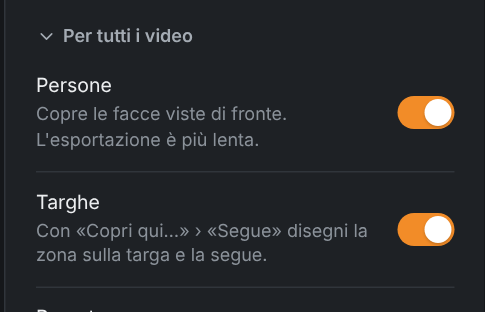

Persone e targhe ora si accendono e spengono con due interruttori in cima al pannello.

## Novità

- **Persone:** copre le facce viste di fronte. Prima si chiamava «Copri anche i volti» ed era in fondo al pannello.
- **Targhe:** acceso, con «Copri qui…» compare la scelta «Segue», che fa seguire la zona alla targa. Spento, le zone «Segue» restano nella lista (con scritto «segue · spenta») ma non vengono usate.
- Tutti e due partono spenti, si ricordano e finiscono anche nei preset.

## Sistemato

- In inglese e tedesco c'era scritto «1 videos» / «1 Videos».
