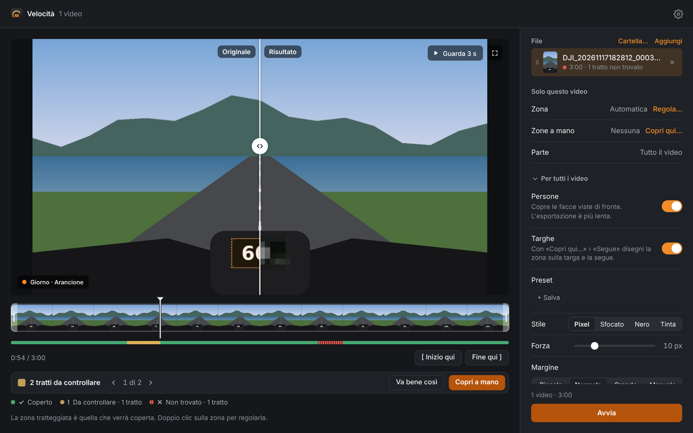
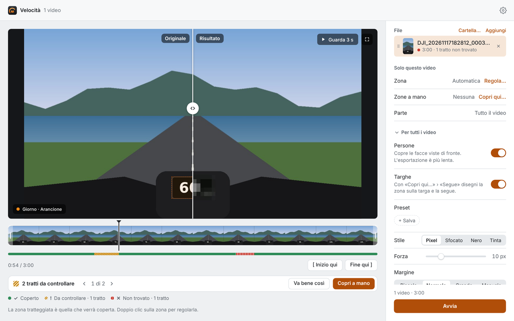

Grafica tutta nuova, i tratti da controllare si sistemano con un clic e l'esportazione con i volti non si blocca più.

## Novità (dalla 0.3.4)

- **Icona e colori nuovi**, con tema chiaro, scuro o automatico (Impostazioni → Aspetto).
- **Prima / Dopo:** una linea da trascinare sopra l'anteprima mostra a sinistra l'originale e a destra il risultato.
- **Linea del tempo con i fotogrammi:** si vede subito dove si è nel video. Le due maniglie ai lati scelgono il pezzo da salvare.
- **Tratti da controllare:** la barra sotto la linea del tempo dice quanti tratti arancioni e rossi ci sono. Con ‹ › si salta da uno all'altro, con «Va bene così» o «Copri a mano» il tratto diventa verde.
- **Miniature** dei video nella lista e **video recenti** nella schermata iniziale.
- Barra di avanzamento a quadratini e, alla fine, il prima / dopo del video salvato.
- **Come funziona:** una piccola guida alla prima apertura (si può rivedere dalle Impostazioni).

## Sistemato

- Con «Copri anche i volti» acceso l'esportazione sul Mac si fermava con l'errore «RefCell already borrowed». Ora funziona.
- Premendo Esc sull'avviso prima dell'esportazione, il video veniva salvato lo stesso.
- Release più veloci da preparare (da circa 15 a circa 8 minuti), senza cambiare niente nell'app.
